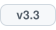
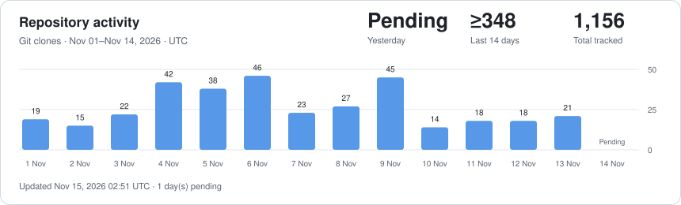
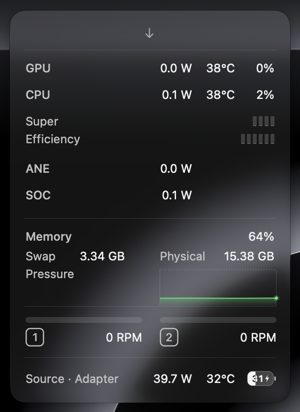
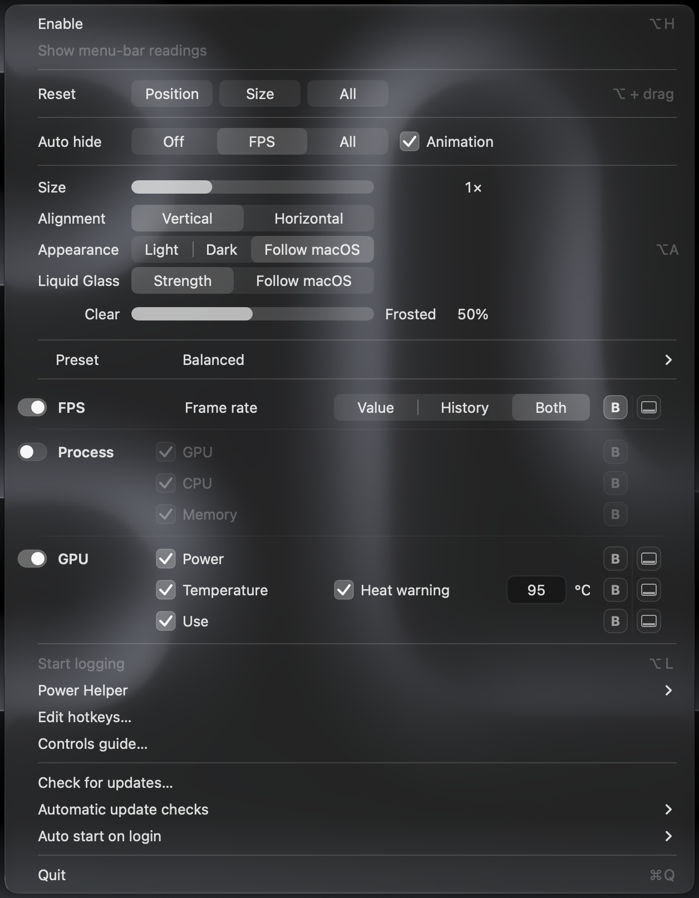
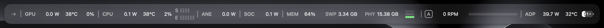
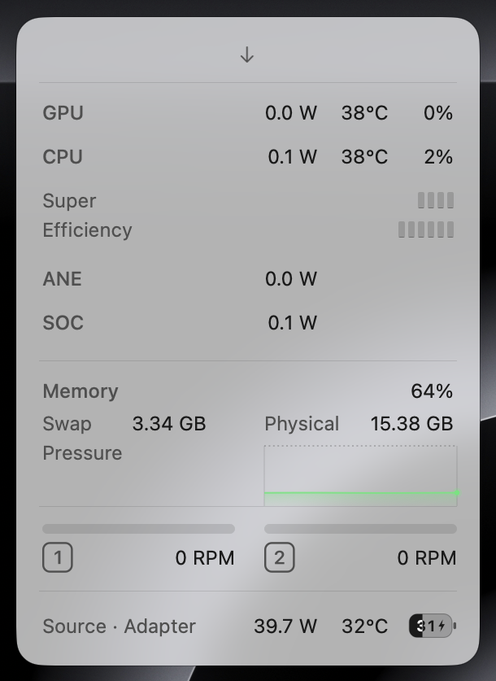
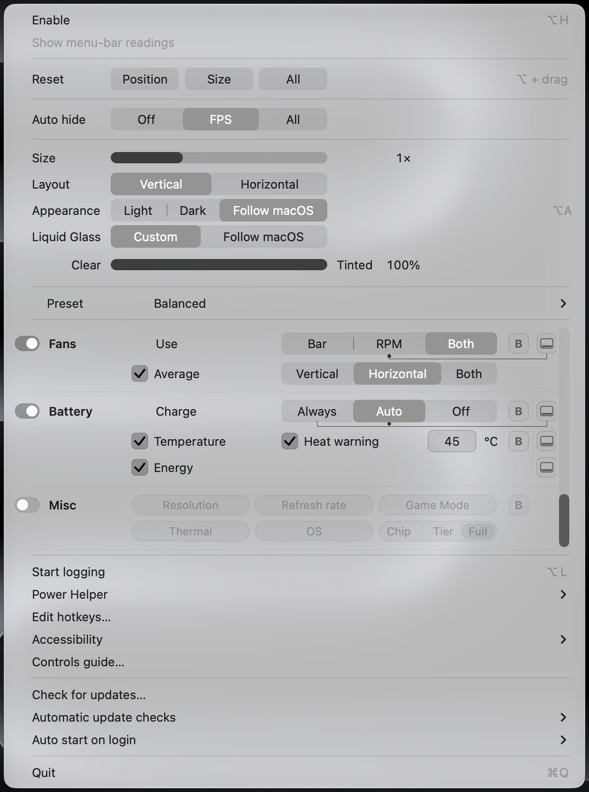
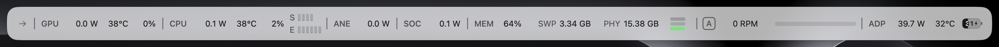

  <picture>
    <source media="(prefers-color-scheme: dark)" srcset="docs/images/banner-dark.webp">
    <source media="(prefers-color-scheme: light)" srcset="docs/images/banner-light.webp">
    
  </picture>

## ↓ Download options &nbsp;

Get the ready-built app for **$3.99**, or build it yourself for free. Both have exactly the same features: no subscription, nothing to unlock.

  &nbsp;
  

Buying the app helps keep PerformanceHUD maintained, and lets you use it personally or commercially, including in monetized videos and streams. Free source builds and modifications are for **personal, non-commercial use**. Resale and external redistribution are not permitted. See the [license](LICENSE) for details.

Whichever version you use, you can also support ongoing development through **[GitHub Sponsors](https://github.com/sponsors/zzoko)**.

  

## ✦ About PerformanceHUD

<table>
<tr>
<td>

<strong>Features, screenshots &amp; controls</strong>

**PerformanceHUD shows what your Mac is doing while you play.** A small overlay sits on top of your game with the live frame rate and what's behind it: CPU and GPU load, temperatures and power draw, memory pressure, fans and battery. It's a native Apple silicon app under 10 MB.

You can use the **FPS** preset for just the frame-rate number, **Balanced** for the everyday essentials, or **Detailed** for everything down to per-core activity, clock speeds and the resolution a game is actually outputting. From there, each reading can be turned on or off, emphasized, or shown as a number, a bar or a graph. A 60-second FPS history makes dips easy to spot, temperatures automatically highlight with a warning in the overlay past certain thresholds, and memory pressure has its own history graph. Lay it out as a vertical panel or a horizontal strip, from 0.5× to 2× size.

The HUD never takes focus from the game, and clicks pass straight through it; hold Option to drag it somewhere else. Toggle it with **Option-H**, even mid-game, or let it hide itself when no frame rate is detected and come back when a game starts rendering. Readings turned off aren't measured at all, so the overlay only samples what you use.

Press **Option-L** to log your selected readings to CSV once per second and compare settings or games in a spreadsheet afterwards. Or pin a few readings to the menu bar to watch your Mac outside games, even with the HUD switched off.

I built PerformanceHUD as the tool I wanted on my own Mac, and I've kept it purposeful with every iteration to be as useful as it can be without adding things for the sake of it or make it bloated. It prioritizes a clean design, low overhead and delivering the important metrics.

<table>
  <tr>
    <th colspan="2">Dark appearance</th>
  </tr>
  <tr>
    <td width="33%" valign="top" align="center">
       
      Vertical HUD
    </td>
    <td width="67%" valign="top" align="center">
       
      Menu controls
    </td>
  </tr>
  <tr>
    <td colspan="2" align="center">
       
      Horizontal HUD
    </td>
  </tr>
</table>

<table>
  <tr>
    <th colspan="2">Light appearance</th>
  </tr>
  <tr>
    <td width="33%" valign="top" align="center">
       
      Vertical HUD
    </td>
    <td width="67%" valign="top" align="center">
       
      Menu controls
    </td>
  </tr>
  <tr>
    <td colspan="2" align="center">
       
      Horizontal HUD
    </td>
  </tr>
</table>

*Liquid Glass follows your macOS setting by default, and its strength can be adjusted in the app.*

</td>
</tr>
</table>

 

## Display compatibility

View display modes and fullscreen compatibility

- **Windowed and borderless (recommended):** The most compatible option; it just works. The HUD stays visible over any game or app, correctly scaled and Retina-sharp regardless of the game's rendering resolution.
- **Fullscreen — native macOS games:** Generally works. Some games change macOS display scaling in exclusive fullscreen, and since the HUD follows macOS scaling, it can end up smaller or larger along with the rest of the system UI. Setting a game to 4K, for example, can shrink it noticeably. If that happens, adjust **Size** in the PerformanceHUD menu (**0.5×** to **2×**) until it fits. Confirmed working in exclusive fullscreen in Stray, and in Minecraft with Vulkan rendering.
- **Fullscreen — Windows games through compatibility layers:** With CrossOver or similar tools, the HUD only appears reliably when the game's fullscreen resolution matches your desktop's current "looks like" resolution, or its 2× Retina equivalent. Confirmed working at matching resolutions in Red Dead Redemption 2 and Resident Evil Requiem through CrossOver. If the HUD disappears, switch to one of those resolutions or to windowed/borderless.

To find your desktop resolution, open **System Settings → Displays** and hover over the selected scaling thumbnail, or choose **Show List**. Double both numbers for the 2× Retina equivalent. A 13-inch MacBook Air at its default scaling, for example, uses **1470×956**, so RDR2 in fullscreen through CrossOver would need an in-game resolution of **1470×956** or **2940×1912**. Windowed and borderless modes don't need a matching resolution at all.

## Requirements

View system requirements

- Apple silicon Mac (M-series), running macOS 27.0 or later.

## More resources

- [Differences between PerformanceHUD and MetalHUD](docs/METAL_HUD_COMPARISON.md)
- [Bugs & suggestions](docs/FEEDBACK.md)
- [Changelog](docs/CHANGELOG.md)
- [Privacy & access](docs/PRIVACY_AND_ACCESS.md)
- [License](LICENSE)
